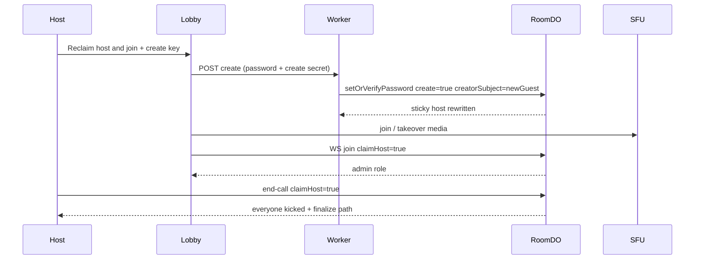

# Telegram voice parity — design (non-breaking)

## Telegram Voice Chat basics (reference)

| Telegram behavior | Why it matters |
|---|---|
| Host identity survives app relaunch (account-bound) | Closing the client never strands a live room without a stop path |
| Explicit **End voice chat** vs personal leave | Leave keeps the room alive; End stops everyone |
| Mute all + raise hand + host unmute | Moderated Q&A / stage model |
| Separate **speaker** vs **listener** invite links | Guests join already muted or speak-ready |
| Invite opens the chat directly | Low friction guest entry |
| Server-side recording started/stopped by host | Recording is not tied to one browser tab |
| Screen-off / background audio in native apps | Calls continue when the phone locks |

## Voice-room today (honest map)

| Area | Status |
|---|---|
| Invite link (`#invite=`) | Done |
| Mute all / unmute all / force mute / raise hand / kick / make admin | Done |
| Server SFU recording + admin download/list/delete | Done |
| Dual plane (SFU media + RoomDO control) | Done — but host signals are OR’d across three sources |
| Host after full browser close | **Gap** — sticky `creatorSubject` points at a dead guest UUID; reclaim required Create mode |
| Emergency End without being in the WebSocket | **Gap** — finalize alone does not kick others |
| Speaker vs listener invites | **Gap** — one invite; late joiners not auto-listener |
| Screen-off two-way audio | Native Capacitor shell only (browser cannot match Telegram) |
| Account-bound host | Out of scope (no Telegram accounts); create key is the host proof |

## Non-breaking upgrade principles

1. **Additive only** — existing Join / Create / invite / mute flows keep working.
2. **Create key = host proof** — same secret already used for create/purge/list.
3. **No new auth product** — do not invent OAuth; reclaim with create key.
4. **Leave ≠ End** — unchanged; End remains explicit.
5. **Degrade safely** — if reclaim fails, show clear next step (not silent guest).

## Priority upgrades (this round)

### P0 — Host continuity

1. **Reclaim host & join** on the lobby (Join mode optional create-key field, or dedicated button) that:
   - Calls existing `RoomApi.create()` (rewrites RoomDO sticky `creatorSubject`)
   - Stores create key in `sessionStorage`
   - Joins media + sends control `join` with `claimHost: true`
2. Lobby copy that states: closed the browser → reclaim with host create key → End call.
3. **Admin “End live call”** — `POST /api/admin/end-call` with create key + room id (+ password when required) that asks RoomDO to run the same end-call path (broadcast + close sockets). Does not require a live host tab.

### P0 — Moderation consistency

4. Send `claimHost: true` on **kick** (and keep it on mute/end) so create-key UI host can actually moderate after reclaim.

### P1 — Listener invites (additive)

5. Optional invite flag `#invite=…&listen=1` (or `listen=1` in hash) so that joiner starts force-muted / cannot self-unmute until host unmutes — Telegram listener link. Speakers keep current invite.

### P2 — Deferred (documented, not this round)

- Account login / multi-device host sync
- Scheduled voice chats + titles as first-class objects
- Incremental Opus for long recordings (WAV fallback remains)
- CallKit / native background (Capacitor path already started)

## Sequence: reclaim after browser close

## Acceptance checks

- [x] Host closes browser mid-call; guests stay connected. *(unchanged Leave ≠ End)*
- [x] Host opens same room URL, enters create key, **Reclaim host & join**, sees End call.
- [x] Host End call stops everyone and finalizes recording.
- [x] Without joining, Admin → End live call (create key) stops the room.
- [x] Guest Join without create key unchanged.
- [x] Listener invite joins muted; speaker invite unchanged.

## Shipped in this round

- Lobby optional host create key → **Reclaim host & join**
- `/admin` **End live call** (`POST /api/admin/end-call`)
- Kick / Make admin send `claimHost: true`
- **Copy speaker link** / **Copy listener link** (`#invite=…&listen=1`)
- Design doc: this file
